# CareFlow Iran — Security Review, Hardening and Residual Risk

Scope: the FastAPI backend, the Next.js frontend and the Docker/CI configuration in this repository.
Data in the repository is synthetic. Nothing here is a certification; it is an engineering review.

## 1. How this was reviewed (and what it was not)

| Method | What was done |
|---|---|
| Manual code review | Every backend module and every frontend file that touches auth, API calls, storage or rendering. |
| SAST | `bandit` (Python). One false positive (seeded demo RNG) suppressed with a reason. |
| Dependency audit | `pip-audit` and `npm audit` before and after. |
| Threat modelling | Attack tree (section 3), mapped to MITRE ATT&CK techniques. |
| Regression pen-test | automated tests (`backend/tests/test_security.py`) that attack the running API through the test client: forged / expired / unsigned tokens, brute force, cross-department access, role abuse, step skipping, injection strings, CORS, oversized bodies, flooding. |
| Performance guards | Per-endpoint SQL statement budgets asserted in the same suite. |

**Not done, stated plainly:**
- No live scan of a deployed environment, no fuzzing campaign, no third-party penetration test.
- Container images were not built or scanned in this session (the review machine could not run Docker). The CI workflow does it on every pull request.
- No load test. Latency numbers in section 6 come from one loaded workstation and are relative, not absolute.

## 2. Findings and status

Severity is the reviewer's estimate. "Test" names the regression test that now guards the control.

| ID | Finding | Sev | Status | Control / test |
|---|---|---|---|---|
| S1 | CORS fell back to `*` with credentials, methods and headers wide open | High | Fixed | Explicit allow-list, no credentials, only `GET/POST/OPTIONS` and two headers; empty list means no cross-origin access. `test_cors_allows_only_the_configured_origin` |
| S2 | Default JWT secret in code, `.env` and compose; anyone with the repo could mint admin tokens | Critical if deployed | Fixed | No default. Production refuses to boot on a missing or short secret; development mints a random per-process secret; compose refuses to start without one. `test_production_refuses_a_weak_secret`, `test_development_never_signs_with_a_guessable_secret` |
| S3 | No authorisation: any signed-in user could read and change any patient | High | Fixed | Role checks, department / care-team scoping, step ownership. Out-of-scope ids return 404 (no existence oracle). `test_clinicians_only_see_their_scope_and_cannot_probe_other_ids`, `test_a_nurse_cannot_complete_a_physician_step`, `test_it_role_sees_aggregates_but_no_patient_records` |
| S4 | No brute-force protection on login | Med-High | Fixed | 20 req/min per IP plus 5 failures / 15 min per (IP, e-mail) lockout; unknown and wrong-password answers are identical and equally slow. `test_repeated_failures_lock_the_account_for_that_client`, `test_unknown_account_and_wrong_password_are_indistinguishable` |
| S5 | Public persona list enumerated accounts | Medium | Fixed | `/auth/demo-users` exists only when `DEMO_MODE=true`; production refuses that flag. |
| S6 | Token in `localStorage`, client-only logout, 12 h lifetime, no revocation | Medium | Partly fixed | 60 min lifetime; `jti`, `iat`, `exp` required; server-side deny-list on logout; strict CSP. **Token still lives in `localStorage`** (see section 7). |
| S7 | Public writes (`/leads`, `/roi/calculate`) unthrottled | Medium | Fixed | Rate limits, honeypot field, field length bounds, 64 KiB body cap. No CAPTCHA. `test_lead_honeypot_stores_nothing_and_flooding_is_throttled`, `test_oversized_bodies_are_refused` |
| S8 | 48 advisories in Python dependencies (PyJWT, python-multipart, starlette, pytest) | High | Fixed | Upgraded; `python-multipart` removed (unused); dev tooling split out. `pip-audit`: **0**. |
| S9 | Next.js 15.1.6 critical advisory, postcss, sharp, source-map-js | Critical | Fixed | Next 15.5.27, `overrides` for postcss and source-map-js. `npm audit`: **0** (was 1 critical, 2 high). |
| S10 | No CSP, HSTS, Permissions-Policy | Medium | Fixed with a caveat | Added on both services. CSP still allows inline scripts (required by Next hydration and the theme no-flash snippet). Nonce-based CSP is the upgrade path. |
| S11 | PBKDF2 at 120 000 rounds | Low | Fixed | 600 000 rounds; legacy hashes upgrade on next login. `test_legacy_hashes_verify_and_are_flagged_for_upgrade` |
| S12 | Demo seed ran on every boot by default | Low | Fixed | Default off; production refuses it. |
| N1 | Any step could be completed out of order (skipping triage, re-completing) | Medium | Fixed | Only the current (active / blocked) step can be completed. `test_steps_cannot_be_completed_out_of_order` |
| N2 | Test suite ran against and mutated the developer database | Low | Fixed | Throw-away database per run. |
| N3 | Login form pre-filled demo e-mail and password in every environment | Medium | Fixed | Fields empty; demo hint shown only when the demo endpoint answers. |
| N4 | Unused public endpoint `/integrations/public-summary` | Low | Removed | Less surface. |
| N5 | Containers: `curl` and tests shipped, all interfaces published, default DB password, db on a routable network | Medium | Fixed | See section 5. |
| N6 | OpenAPI docs exposed regardless of environment | Low | Fixed | Off whenever `APP_ENV=production`. |
| N9 | Rate-limit key came from the first `X-Forwarded-For` entry, which a client controls | Medium | Fixed | Only used when `TRUST_PROXY_HEADERS=true`; takes the last entry (written by our proxy), must parse as an IP. `test_forwarded_for_is_only_trusted_when_configured_and_uses_the_proxy_entry` |
| N10 | Request bodies silently accepted unknown fields (mass-assignment risk) | Low | Fixed | `extra="forbid"` on every inbound model. `test_unknown_fields_are_rejected_not_ignored` |
| N11 | Tokens carried no issuer or audience | Low | Fixed | `iss` / `aud` required and verified. Parametrised bad-token tests cover both. |
| N12 | Audit lines could not be tied to one request | Low | Fixed | Server-generated `x-request-id` on every response and in every audit line; client-supplied ids are never logged. `test_every_response_carries_a_server_generated_request_id` |
| N7 | Three dashboard KPI deltas are constants (`+3.4`, `-4.1`, `-11.5`), shown as if measured | Medium (integrity) | **Open** | Marked in code. Needs stored history for adherence, length of stay and blocked steps. Product decision: hide or compute. |
| N8 | `records@careflow.ir` is a medical-records officer seeded with the `it` role, so it now sees aggregates only | Decision | **Open** | Add a read-only `records` role if that persona needs patient lookup. |

## 3. Attack tree

Root goal: **read or alter hospital operational / patient data, or take the service down.**
`AND` / `OR` shown by structure. Status is after hardening.

```mermaid
graph TD
  R["Read/alter data or disrupt service"]
  R --> A["A. Become a legitimate user"]
  R --> B["B. Abuse what a legitimate user may do"]
  R --> C["C. Compromise via supply chain"]
  R --> D["D. Deny service"]
  R --> E["E. Attack the platform"]

  A --> A1["A1 Forge token with default secret<br/>(cost low, skill low) - MITIGATED: no default, prod fail-closed"]
  A --> A2["A2 Brute-force / credential-stuff login<br/>(cost low) - THROTTLED + lockout + audit log"]
  A --> A3["A3 Steal token via XSS<br/>(skill high) - PARTLY: CSP, no raw HTML sinks; token in localStorage"]
  A --> A4["A4 Replay a stolen token<br/>- LIMITED: 60 min, revocable on logout"]

  B --> B1["B1 IDOR across departments - MITIGATED: scoped, 404"]
  B --> B2["B2 Role abuse (nurse completes physician step) - MITIGATED: 403"]
  B --> B3["B3 Skip pathway steps - MITIGATED: 409"]
  B --> B4["B4 Read patients as IT role - MITIGATED: 403"]

  C --> C1["C1 Known-vulnerable dependency - MITIGATED: 0 advisories, weekly CI + Dependabot"]
  C --> C2["C2 Malicious / typosquatted package - OPEN: lockfiles pinned, install scripts disabled in CI"]

  D --> D1["D1 Flood public endpoints - MITIGATED: rate limits"]
  D --> D2["D2 Oversized body - MITIGATED: 413 at 64 KiB"]
  D --> D3["D3 Make API do heavy work per request - MITIGATED: N+1 removed, SQL aggregation"]
  D --> D4["D4 Burn CPU with login hashing - MITIGATED: per-IP limit, password length cap"]

  E --> E1["E1 Reach the database from outside - MITIGATED: internal network, no published port"]
  E --> E2["E2 Escalate inside a container - REDUCED: non-root, caps dropped, read-only root fs"]
  E --> E3["E3 Production started with demo settings - MITIGATED: boot refuses"]
```

Highest-value paths an attacker would still try, in order: **A3** (token theft), **C2** (supply chain),
then credential reuse against a real deployment with real user passwords.

## 4. Red team and blue team view

**Red team (ATT&CK mapping)**

| Technique | Attempted path | Result |
|---|---|---|
| T1110 Brute force | Repeated logins for one account | 429 after 5 failures; correct password refused while locked |
| T1078 Valid accounts | Token signed with a guessed or foreign secret, `alg=none`, wrong algorithm, expired, no `jti` | All 401 |
| T1190 Exploit public app | SQL metacharacters in search; `%` and `_` wildcards | Treated as data; table intact |
| T1565 Data manipulation | Complete a step you do not own; complete a future step | 403 / 409 |
| T1087 Account discovery | Compare unknown vs wrong-password responses; probe patient ids | Identical bodies; 404 for out-of-scope ids |
| T1499 Endpoint DoS | 70 KB body; lead flood | 413; 429 |
| T1552 Credentials in files | Repository, compose, `.env.example` | No working secret remains in tracked files |

**Blue team (detect and respond)**

- Every security-relevant action writes one line to the `careflow.audit` logger: `login.ok`, `login.failed`,
  `login.locked`, `logout`, `step.advanced`, `step.denied`, `message.posted`, `alert.acknowledged`, `lead.honeypot`.
  Lines carry ids only, never names, MRNs or message text.
- Suggested alerts once logs reach a SIEM: more than 10 `login.failed` per minute from one source; any `login.locked`;
  repeated `step.denied` by one user; a sudden rise in HTTP 429.
- Incident response, token compromise: rotate `JWT_SECRET` and restart. Every outstanding token becomes invalid.
- Incident response, account compromise: set `is_active=false` on the user; the next request is refused.

## 5. Platform hardening

| Area | Change |
|---|---|
| API image | Runtime dependencies only (no curl, no pytest, no tests), numeric non-root user, shell disabled, healthcheck without extra tooling, `--no-server-header`. |
| Compose | rotated json logs, `noexec` tmpfs, `no-new-privileges`, all capabilities dropped (database keeps the five its entrypoint needs), read-only root filesystem for api and web, memory and pid limits, ports bound to `127.0.0.1`, database on an `internal` network with no outbound route, required secrets (`:?`) so it cannot start with blanks. |
| CI | `.github/workflows/security.yml`: gitleaks (full history), Semgrep + bandit (SAST), pip-audit and npm audit (SCA), pytest, production build, hadolint, trivy config + image scan, CycloneDX SBOM, and one `gate` job to require in branch protection. Weekly schedule so new advisories surface without a code change. `dependabot.yml` for pip, npm, docker and actions; `.pre-commit-config.yaml` for local gitleaks + bandit. Third-party actions are pinned to full commit SHAs (tag kept as a comment); GitHub-owned `actions/*` stay on major tags; Dependabot proposes SHA bumps. The Semgrep job still uses a floating container image tag (backlog: pin by digest). DAST (OWASP ZAP baseline) needs a staging URL and is listed in the backlog. |
| Headers | API: `nosniff`, `DENY` framing, `no-store`, `default-src 'none'`, HSTS in production. Web: CSP, HSTS, Permissions-Policy, COOP, `DENY`. |

## 6. Performance paired with the security work

Same database copy, same interpreter, only the application code differs. Median of 7 requests after warm-up,
loaded workstation, so read the ratios and not the milliseconds.

| Endpoint | SQL statements before → after | Median before → after | Bytes on the wire before → after |
|---|---|---|---|
| `GET /patients?status=active&limit=300` | 140 → 3 | 2 003 ms → 595 ms | 61.3 KiB → 7.8 KiB |
| `GET /pathways` | 113 → 5 | 1 543 ms → 280 ms | 6.4 KiB → 2.0 KiB |
| `GET /overview` | 6 → 7 | 1 013 ms → 253 ms | 1.5 KiB → 0.7 KiB |
| `GET /departments` | 10 → 4 | 748 ms → 201 ms | 2.0 KiB → 0.7 KiB |
| `GET /analytics/occupancy` | 2 → 2 | 340 ms → 191 ms | 10.4 KiB → 1.4 KiB |
| `GET /analytics/resource-demand` | 9 → 3 | 571 ms → 325 ms | 1.5 KiB → 0.5 KiB |

What produced it: eager loading and SQL-side filtering and limits (patients, pathways); aggregation in SQL instead of
loading whole tables (overview, analytics); one query for all departments instead of one each; indexes on the hot filter
columns; gzip. Security cost paid back: PBKDF2 at 600 000 rounds adds roughly a quarter second per login on a normal
machine, which is why login is rate-limited per IP and the password length is capped.

## 7. Residual risk and backlog (ordered)

1. **Token in `localStorage`.** Any script that runs on the page can read it. Move to an `HttpOnly; Secure; SameSite=Strict`
   cookie with CSRF protection, and issue short access tokens plus a rotating refresh token.
2. **Process-local state.** Rate limits and the revocation list live in memory, so run one worker. Before scaling out,
   move both to Redis. The code marks both places.
3. **No schema migrations.** `create_all` does not add the new indexes to a database that already exists. Introduce Alembic
   before the first real deployment; for the demo database, delete and reseed.
4. **CSP allows inline scripts.** Add per-request nonces.
5. **No MFA, no password policy, no account recovery.** Required before real users. Demo accounts only exist in demo mode.
6. **Audit trail is log lines, not tamper-evident.** Clinical systems usually need an append-only store with retention rules.
7. **Encryption at rest and TLS** are deployment concerns (database volume, reverse proxy). Not provided here.
8. **Argon2id** is preferable to PBKDF2 if a compiled dependency is acceptable.
9. **Real patient data** brings legal obligations (Iranian health-data rules and hospital policy). A legal review is a
   precondition, not a task for this repository.
10. **Frontend tests are absent.** See QA notes below.

## 8. Role reviews

**Product owner**
- Decide the access model explicitly: managers see everything; clinicians see their department and their care teams;
  IT sees aggregates only. Ratify or change it (finding N8).
- Do not ship constant KPI deltas as measurements (N7).
- Demo mode is a feature flag, not a default. Sales demos run with `APP_ENV=development`.

**Tech lead**
- Single-worker constraint and the Redis step (backlog 2); Alembic (backlog 3).
- Every patient read now goes through one scoped loader, so a new endpoint cannot forget the check if it uses it.
  Keep that rule in code review.
- Synchronous handlers run in a thread pool; password hashing is the only CPU-heavy call and is bounded.

**QA**
- Backend: 53 tests, all passing on the pinned dependency set. The suite uses a temporary database and is repeatable.
- Gaps: no browser tests, no accessibility scan, no RTL visual regression, no load test.
  Suggested first additions: Playwright smoke for login, patient list, step completion in both locales and both themes;
  axe-core on the five main screens; a k6 script against the three heaviest endpoints.
- Exploratory hints: sign in as each role and open every nav item; open a patient id outside your department by URL;
  let a token expire during a form edit; use the app at 200 % zoom in Persian.

## 9. Dependency-advisory lifecycle (threat intelligence for this project)

Priority intelligence requirements, in the order they drive collection:

| PIR | Question | Sources | Owner |
|---|---|---|---|
| 1 | Is any component in the auth / web chain (PyJWT, FastAPI, Starlette, Next.js) affected by a known-exploited vulnerability? | CISA KEV, GitHub advisories, `pip-audit`, `npm audit` | Tech lead |
| 2 | Do new advisories touch code paths this app actually uses? | Advisory text plus the dependency graph | Backend developer |
| 3 | Are credentials or tokens for this system exposed (repository history, logs, paste sites)? | gitleaks in CI and pre-commit | Everyone |
| 4 | Which attack techniques are being used against hospital web apps this quarter? | Sector bulletins, vendor reports | Product owner + security |

| Phase | Practice |
|---|---|
| Direction | Assets that matter: authentication libraries (PyJWT), the web framework chain (FastAPI, Starlette), the UI framework (Next.js), database driver and image. |
| Collection | OSV and PyPI advisories via `pip-audit`; the npm advisory database via `npm audit`; GitHub Dependabot; CISA Known Exploited Vulnerabilities checked manually for anything in the chain above. |
| Processing | CI runs on every pull request and weekly. |
| Analysis | Ask whether the vulnerable code is reachable here (example: `python-multipart` was unused, so it was removed instead of patched). |
| Dissemination | Dependabot pull requests and CI failures are the notification. |
| Feedback | Target response: known-exploited or critical in 2 days, high in 7, medium in 30. Review misses after each incident. |

## 10. Pre-deployment checklist

- [ ] `APP_ENV=production`, `SEED_ON_STARTUP=false`, `DEMO_MODE=false`
- [ ] `JWT_SECRET` and `POSTGRES_PASSWORD` generated (at least 32 random characters), stored in a secret manager
- [ ] `CORS_ORIGINS` is the exact public web origin
- [ ] TLS terminates in front of both services; `TRUST_PROXY_HEADERS=true` only behind your own proxy
- [ ] Database volume encrypted and backed up; restore tested
- [ ] Logs from `careflow.audit` shipped and alerted on
- [ ] CI green, images scanned, no open high advisories
- [ ] Migration tool in place (backlog 3)
- [ ] Demo accounts removed; real accounts have unique strong passwords
